# Inkra

A note app for macOS, written in Rust on GPUI, the UI framework of the Zed
editor. Your notes stay plain markdown files in a folder
(a vault); Inkra reads and writes them in place.

- Markdown live preview: styled as you type, markup hidden until the caret
  or the selection touches it.
- `[[Wikilinks]]`, a backlinks panel, `⌘Enter` to follow a link.
- `⌘P` quick open, `⌘⇧F` vault search, `⌘⇧P` command palette.
- Tabs with per-tab back and forward, `⌘⇧T` to reopen a closed tab.
- Autosave, conflict detection, and a file watcher that follows edits made
  outside the app.
- No persisted index yet: the vault is scanned and indexed at each launch.

## Run

Requires macOS and Rust 1.96 or later.

```sh
./scripts/vendor-gpui.sh          # once: fetches gpui at the pinned commit
cargo run --release -p inkra-app -- ~/path/to/vault
```

## Performance

Inkra against Obsidian on the same generated vaults, measured from outside
both apps by the same tool. Method, isolation and caveats:
[docs/benchmarks.md](docs/benchmarks.md).

Apple M5 Pro, 48 GB, macOS 26.5. Inkra 0.1.0 (commit `698daa8`), Obsidian
1.12.7, 2026-09-30. Warm rows: median of 5 runs. Memory is Activity Monitor's
figure (`phys_footprint`, summed over every process of the app), in MiB.

```mermaid
---
config:
  themeVariables:
    fontFamily: "ui-monospace, SFMono-Regular, Menlo, monospace"
    xyChart:
      backgroundColor: "#2f3440"
      titleColor: "#e5e7eb"
      xAxisLabelColor: "#d1d5db"
      yAxisLabelColor: "#d1d5db"
      xAxisTitleColor: "#d1d5db"
      yAxisTitleColor: "#d1d5db"
      xAxisLineColor: "#4b5563"
      yAxisLineColor: "#4b5563"
      xAxisTickColor: "#4b5563"
      yAxisTickColor: "#4b5563"
      plotColorPalette: "#93c5d3, #6b7a8f"
---
xychart-beta horizontal
    title "Window on screen, warm (lower is better)"
    x-axis ["Inkra 500 · 159 ms", "Obsidian 500 · 424 ms", "Inkra 5k · 150 ms", "Obsidian 5k · 444 ms", "Inkra 50k · 154 ms", "Obsidian 50k · 426 ms"]
    y-axis "ms" 0 --> 500
    bar [159, 0, 150, 0, 154, 0]
    bar [0, 424, 0, 444, 0, 426]
```

```mermaid
---
config:
  themeVariables:
    fontFamily: "ui-monospace, SFMono-Regular, Menlo, monospace"
    xyChart:
      backgroundColor: "#2f3440"
      titleColor: "#e5e7eb"
      xAxisLabelColor: "#d1d5db"
      yAxisLabelColor: "#d1d5db"
      xAxisTitleColor: "#d1d5db"
      yAxisTitleColor: "#d1d5db"
      xAxisLineColor: "#4b5563"
      yAxisLineColor: "#4b5563"
      xAxisTickColor: "#4b5563"
      yAxisTickColor: "#4b5563"
      plotColorPalette: "#93c5d3, #6b7a8f"
---
xychart-beta horizontal
    title "Memory at idle, warm (lower is better)"
    x-axis ["Inkra 500 · 50 MiB", "Obsidian 500 · 222 MiB", "Inkra 5k · 106 MiB", "Obsidian 5k · 340 MiB", "Inkra 50k · 465 MiB", "Obsidian 50k · 909 MiB"]
    y-axis "MiB" 0 --> 1000
    bar [50, 0, 106, 0, 465, 0]
    bar [0, 222, 0, 340, 0, 909]
```

```mermaid
---
config:
  themeVariables:
    fontFamily: "ui-monospace, SFMono-Regular, Menlo, monospace"
    xyChart:
      backgroundColor: "#2f3440"
      titleColor: "#e5e7eb"
      xAxisLabelColor: "#d1d5db"
      yAxisLabelColor: "#d1d5db"
      xAxisTitleColor: "#d1d5db"
      yAxisTitleColor: "#d1d5db"
      xAxisLineColor: "#4b5563"
      yAxisLineColor: "#4b5563"
      xAxisTickColor: "#4b5563"
      yAxisTickColor: "#4b5563"
      plotColorPalette: "#93c5d3, #6b7a8f"
---
xychart-beta horizontal
    title "CPU until idle, first open (lower is better)"
    x-axis ["Inkra 500 · 0.29 s", "Obsidian 500 · 2.52 s", "Inkra 5k · 1.58 s", "Obsidian 5k · 14.98 s", "Inkra 50k · 15.02 s", "Obsidian 50k · 161.43 s"]
    y-axis "s" 0 --> 170
    bar [0.29, 0, 1.58, 0, 15.02, 0]
    bar [0, 2.52, 0, 14.98, 0, 161.43]
```

```mermaid
---
config:
  themeVariables:
    fontFamily: "ui-monospace, SFMono-Regular, Menlo, monospace"
    xyChart:
      backgroundColor: "#2f3440"
      titleColor: "#e5e7eb"
      xAxisLabelColor: "#d1d5db"
      yAxisLabelColor: "#d1d5db"
      xAxisTitleColor: "#d1d5db"
      yAxisTitleColor: "#d1d5db"
      xAxisLineColor: "#4b5563"
      yAxisLineColor: "#4b5563"
      xAxisTickColor: "#4b5563"
      yAxisTickColor: "#4b5563"
      plotColorPalette: "#93c5d3, #6b7a8f"
---
xychart-beta horizontal
    title "CPU until idle, warm (lower is better)"
    x-axis ["Inkra 500 · 0.28 s", "Obsidian 500 · 0.99 s", "Inkra 5k · 1.74 s", "Obsidian 5k · 1.49 s", "Inkra 50k · 19.58 s", "Obsidian 50k · 7.87 s"]
    y-axis "s" 0 --> 20
    bar [0.28, 0, 1.74, 0, 19.58, 0]
    bar [0, 0.99, 0, 1.49, 0, 7.87]
```









| Notes | App | Open | Window on screen (ms) | Busy until idle (s) | CPU until idle (s) | Memory at idle (MiB) | Processes |
|---:|---|---|---:|---:|---:|---:|---:|
| 500 | Inkra | warm | **159** | **0.3** | **0.28** | **50** | 1 |
| 500 | Obsidian | warm | 424 | 1.3 | 0.99 | 222 | 4 |
| 5,000 | Inkra | warm | **150** | **0.3** | 1.74 | **106** | 1 |
| 5,000 | Obsidian | warm | 444 | 1.3 | 1.49 | 340 | 4 |
| 50,000 | Inkra | warm | **154** | **1.6** | 19.58 | **465** | 1 |
| 50,000 | Obsidian | warm | 426 | 13 | 7.87 | 909 | 4 |
| 50,000 | Inkra | first open | **141** | **1.6** | **15.02** | **462** | 1 |
| 50,000 | Obsidian | first open | 476 | 64.3 | 161.43 | 881 | 4 |

Install size: Inkra 12 MB (release binary, no `.app` bundle yet), Obsidian
482 MB (`.app`).

Read these figures with their limits:

- One machine, Obsidian with default settings and no plugins (automatic
  updates off).
- "Window on screen" is not "note readable" for either app.
- Inkra re-indexes the vault at every launch, so its warm runs do the work
  of a first open: at 50,000 notes it spends more CPU at launch than
  Obsidian, which caches its index.
- Idle CPU is left out here: it depends on whether the window was covered.
  See the full table in `docs/benchmarks.md`.

Reproduce with `./scripts/bench-compare.sh` (quit Obsidian first).

## Development

`./scripts/check.sh` runs the build, tests, clippy, fmt and `cargo deny`; green
is the definition of done. Architecture and conventions are in
[CLAUDE.md](CLAUDE.md), design specs in `docs/superpowers/specs/`.
