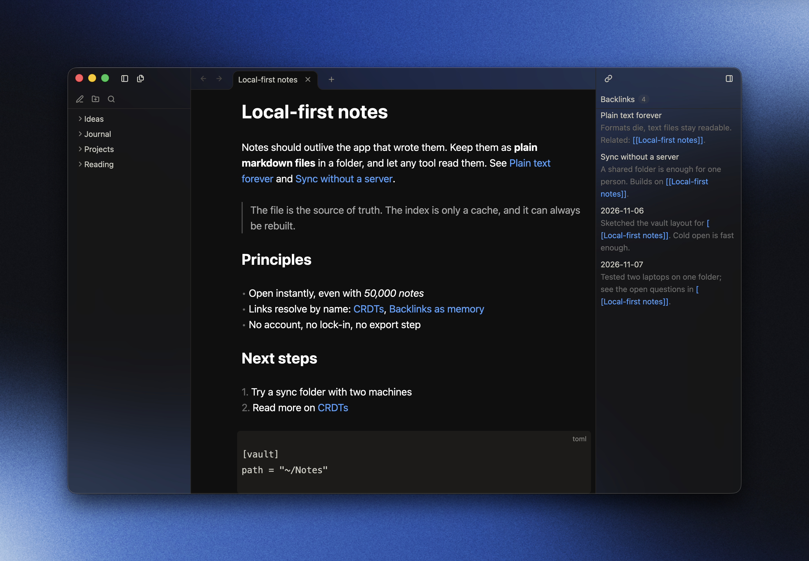

# Inkra

A fast, native note app for macOS. Your notes stay plain markdown files in a
folder (a vault); Inkra reads and writes them in place.

Written in Rust on [GPUI](https://github.com/zed-industries/zed/tree/main/crates/gpui),
the GPU-rendered UI framework of the Zed editor. No Electron, no web view:
one 17 MB binary, one process.



> **Status: early.** Inkra is usable day to day but young. macOS only, built
> from source, no `.app` bundle yet. Formats may change between commits.

## Features

- **Markdown live preview**: styled as you type, markup hidden until the caret
  or the selection touches it. Quotes, lists and code blocks.
- **Links**: `[[wikilinks]]` to notes and files, a backlinks panel, `⌘Enter`
  to follow a link.
- **Search**: `⌘P` quick open by word start on names and text, `⌘⇧F` vault
  search ranked by BM25, `⌘⇧P` command palette.
- **Tabs and splits**: tabs with per-tab back and forward, `⌘⇧T` to reopen a
  closed tab, split groups in any direction, tabs dragged between them.
- **Docks**: the file tree and the backlinks panel move between the left and
  the right dock, `⌘\` and `⌘|` hide them.
- **Themes**: built-in themes and your own JSON themes in `<vault>/.inkra/`,
  reloaded on save.
- **Files**: images open in a tab; other files show in the tree.
- **Safe with your files**: autosave, conflict detection, and a file watcher
  that follows edits made outside the app.
- **Instant reopen**: the index is cached on disk, the last tabs come back.

Not yet: task boxes, syntax highlighting in code blocks, plugins, sync, Windows
and Linux.

## Performance

Inkra against Obsidian on the same generated vaults, measured from outside
both apps by the same script. Warm open, median of 5 runs, Apple M5 Pro,
macOS 26.5, 2026-11-08. Inkra 0.1.0, Obsidian 1.14.5 with no plugins.

```text
              Window on screen, warm (lower is better)
              █ Inkra   ▒ Obsidian

   Inkra 500 ┤███████████ 112     ·         ·         ·         ·
Obsidian 500 ┤▒▒▒▒▒▒▒▒▒▒▒▒▒▒▒▒▒▒▒▒▒▒▒▒▒▒▒▒▒▒ 296      ·         ·
    Inkra 5k ┤███████████ 112     ·         ·         ·         ·
 Obsidian 5k ┤▒▒▒▒▒▒▒▒▒▒▒▒▒▒▒▒▒▒▒▒▒▒▒▒▒▒▒▒▒▒ 295      ·         ·
   Inkra 50k ┤███████████ 114     ·         ·         ·         ·
Obsidian 50k ┤▒▒▒▒▒▒▒▒▒▒▒▒▒▒▒▒▒▒▒▒▒▒▒▒▒▒▒▒▒ 294       ·         ·
             └┬─────────┬─────────┬─────────┬─────────┬─────────┬
              0        100       200       300       400       500  ms


              Memory at idle, warm (lower is better)
              █ Inkra   ▒ Obsidian

   Inkra 500 ┤███ 52    ·         ·         ·         ·         ·
Obsidian 500 ┤▒▒▒▒▒▒▒▒▒▒▒ 228     ·         ·         ·         ·
    Inkra 5k ┤████ 82   ·         ·         ·         ·         ·
 Obsidian 5k ┤▒▒▒▒▒▒▒▒▒▒▒▒▒▒▒▒▒▒▒ 372       ·         ·         ·
   Inkra 50k ┤█████████████ 261   ·         ·         ·         ·
Obsidian 50k ┤▒▒▒▒▒▒▒▒▒▒▒▒▒▒▒▒▒▒▒▒▒▒▒▒▒▒▒▒▒▒▒▒▒▒▒▒▒▒▒▒▒▒▒▒▒▒ 924
             └┬─────────┬─────────┬─────────┬─────────┬─────────┬
              0        200       400       600       800      1000  MiB


              CPU until idle, first open (lower is better)
              █ Inkra   ▒ Obsidian

   Inkra 500 ┤█ 0.17    ·         ·         ·         ·         ·
Obsidian 500 ┤▒ 1.84    ·         ·         ·         ·         ·
    Inkra 5k ┤█ 0.78    ·         ·         ·         ·         ·
 Obsidian 5k ┤▒▒▒▒ 9.92 ·         ·         ·         ·         ·
   Inkra 50k ┤█████ 11.52         ·         ·         ·         ·
Obsidian 50k ┤▒▒▒▒▒▒▒▒▒▒▒▒▒▒▒▒▒▒▒▒▒▒▒▒▒▒▒▒▒▒▒▒▒▒▒▒▒▒▒▒▒▒ 105.77 ·
             └┬─────────┬─────────┬─────────┬─────────┬─────────┬
              0        25        50        75        100       125  s


              CPU until idle, warm (lower is better)
              █ Inkra   ▒ Obsidian

   Inkra 500 ┤█ 0.11    ·         ·         ·         ·         ·
Obsidian 500 ┤▒▒▒▒ 0.75 ·         ·         ·         ·         ·
    Inkra 5k ┤█ 0.17    ·         ·         ·         ·         ·
 Obsidian 5k ┤▒▒▒▒▒ 1.07          ·         ·         ·         ·
   Inkra 50k ┤████ 0.75 ·         ·         ·         ·         ·
Obsidian 50k ┤▒▒▒▒▒▒▒▒▒▒▒▒▒▒▒▒▒▒▒▒▒▒▒▒▒▒▒ 5.42        ·         ·
             └┬─────────┬─────────┬─────────┬─────────┬─────────┬
              0         2         4         6         8        10  s
```

| Notes | | Window on screen | CPU until idle | Memory at idle |
|---:|---|---:|---:|---:|
| 500 | Inkra | **112 ms** | **0.11 s** | **52 MiB** |
| | Obsidian | 296 ms | 0.75 s | 228 MiB |
| 5,000 | Inkra | **112 ms** | **0.17 s** | **82 MiB** |
| | Obsidian | 295 ms | 1.07 s | 372 MiB |
| 50,000 | Inkra | **114 ms** | **0.75 s** | **261 MiB** |
| | Obsidian | 294 ms | 5.42 s | 924 MiB |

First open of a 50,000-note vault: 11.5 s of CPU for Inkra, 105.8 s for
Obsidian. Install size: 17 MB against 530 MB.

Read these figures with their limits: one machine, default settings, and
"window on screen" is not "note readable" for either app. At idle Obsidian
uses less CPU (0.04 % against 0.3 %). Method, cold-cache runs and the full
tables: [docs/benchmarks.md](docs/benchmarks.md). Reproduce with
`./scripts/bench-compare.sh` (quit Obsidian first).

## Build and run

Requires macOS and Rust 1.96 or later.

```sh
cargo run --release -p inkra-app -- ~/path/to/vault
```

The first build fetches gpui from Zed's repository, at a pinned commit.

## Accessibility

Screen readers cannot read note text yet: GPUI's accessibility bridge exposes
no text properties. This is a known gap, tracked in
[docs/gpui-accessibility.md](docs/gpui-accessibility.md).

## Development

`./scripts/check.sh` runs the build, tests, clippy, fmt and `cargo deny`; green
is the definition of done. The workspace is split into crates with one role
each (`text`, `editor`, `markdown`, `index`, `vault`, `tabs`, `layout`, `app`);
only `app` depends on GPUI. Architecture and conventions are in
[CLAUDE.md](CLAUDE.md), design specs in `docs/superpowers/specs/`, deferred
work in [docs/roadmap.md](docs/roadmap.md).

## License

[GPL-3.0-or-later](LICENSE). You may use, change and share Inkra, including
commercially, as long as what you distribute stays open under the same
license.
